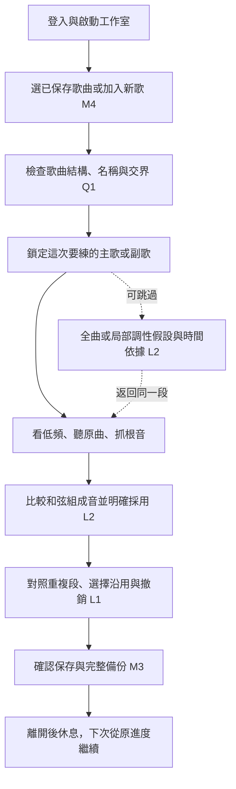

# 2026-11-21：可用版本之後的維護與學習故事

2026-11-23 接續：本表保留11-21交付證據；新增可靠性修復、全清單對照與目前排序見 [總盤點](Backlog_Review_2026-11-23.md)，下一個session先讀 [維護交接](MAINTENANCE_HANDOFF.md)。

使用者已簡單操作，確認對抓歌學習者是可使用的版本；要求擴充 guitarscribe-autopilot 讓新 session 可維護雲端，並完成剩餘故事。使用者暫離不阻塞工程。以本表取代舊歷史表的優先順序；保留現有原曲／低頻／人工稿操作與雲端最新進度。

| ID | 故事／驗收 | 狀態 | 下一步／證據 |
| --- | --- | --- | --- |
| M1 | 新 session 能檢查雲端狀態、辨識故障層級、備份還原及安全改版 | done | skill、3項狀態安全測試、真雲端巡檢／備份／純程式發布均完成。08:50台北：入口Ready、登入200／匿名401、VM休息且可喚醒；6份完整manifest，最新08:44。維護可從 deployment.json／app-release-manifest.json 接手。 |
| M2 | 改版後全套自動測試可靠，能分辨測試環境與產品回歸 | done | 正式 app f269caa 遠端 CI 44845440050 三工作全通過；功能基底9053368亦全通過。未刪測試或放寬音樂閘門；保留既有環境／私人素材條件skip。見 Cloud_Update_2026-11-21。 |
| M3 | 看得懂使用時數、備份狀況與費用限制；備份失敗可見 | done | 備份狀態／保留最近成功紀錄／pending、failed、interrupted 顯示，本機 40 項後端＋1 項瀏覽器通過。已部署，正式API顯示complete；08:43:03快照／08:44:37完成，150檔，timer與重開機設定已核對。保留策略見 Cloud_Maintenance_2026-11-21；實際帳單待累積。 |
| M4 | YouTube 無法下載時仍能明確、可靠地加入新歌 | done | 修正選音檔仍誤送殘留YouTube網址；4項來源操作測試通過，含拒絕下載→改上傳→保存→重開。服務回應為受控fixture；未聲稱能下載被封鎖的來源。已部署。 |
| L1 | 完成一段完整和弦後，先比較再沿用至重複段，保留不同結尾及已填部分 | done | 後端30項新測試／96項相關回歸、真API端到端沿用與重開復原通過；WebKit涵蓋未確認禁套用、範圍變更清除預覽、晚回覆與斷線回復。完整CI通過並部署；正式雲端專用測試歌沿用／重開／撤銷通過，清理後6個既有DB不變。 |
| L2 | 找主音／調式→抓根音→比較組成音，保存自己的假設與依據 | done | 全曲／局部假設與時間依據、字典組成音、主音／逐音／合奏參考聲已實作；9後端、3理論、Chromium與WebKit各2真API流程通過。已補所選範圍錄音音級能量與根音／交界變更重聽提醒，共89項後端回歸及WebKit4項真API通過。9053368完整CI通過、f269caa補手機勾選樣式並部署；正式雲端保存／衝突、真歌1440 Chromium與390 WebKit原曲／能量驗證通過；不自動推定和弦或生成羅馬數字，見 Learning_Practice_2026-11-21。 |
| Q1 | 換歌仍能整理合理大段，能記錄哪些名稱／邊界需要修正 | engineering_done_awaiting_reference | 新唯讀整理報告＋24項測試，核對06:10完整備份中的三首歌，分開名稱／交界淨修改、確認狀態與未知音樂準確率。未記錄的實際聽辨時間、獨立標註與未見曲泛化仍未知；見 Structure_Review_Evidence_2026-11-21。 |
| Q2 | 手機介紹時播放、背景切換與長時間操作穩定 | engineering_done_awaiting_device | WebKit20項手機觸控／背景停止／A-B／和弦保存與沿用通過（Linux WebKit模擬，非實體iPhone）。已加入CI；10分鐘真API編輯／保存／重載／播放／離頁停止循環通過（至少11輪、零頁面錯誤、來源稿不變）；非數小時／實體裝置證據。正式雲端390 WebKit／1440 Chromium原曲無混音與零溢出通過。見 evaluation/practice-soak-2026-11-21.json。 |

本輪不重開主旋律研發、多人帳號、公開分享或匯出擴充，不以新功能重設人工稿。正常修正、驗證、commit／push與既有個人雲端部署沿用授權；同步 programmer-session 的檔案分工，只有主 session 部署。

完成定義：相關失敗先重現、修正後必要測試通過、操作能在整合環境完成、資料保護已驗證、文檔與實際版本一致。工程完成與待長期／人耳／實體設備證據分開。每項完成更新本表，不把待測項阻塞其他工作。

## 現行故事地圖

M1 維護 skill 與 M2 CI 支援整條流程；Q2 覆蓋原介面的手機介紹與持續操作。每一步保留「未定／待聽」，不用填完整首才可繼續。Q1 的獨立音樂標註、Q2 的實體設備／數小時證據，以及實際月帳單仍需外部資料或時間；不重問已接受的歌曲。
